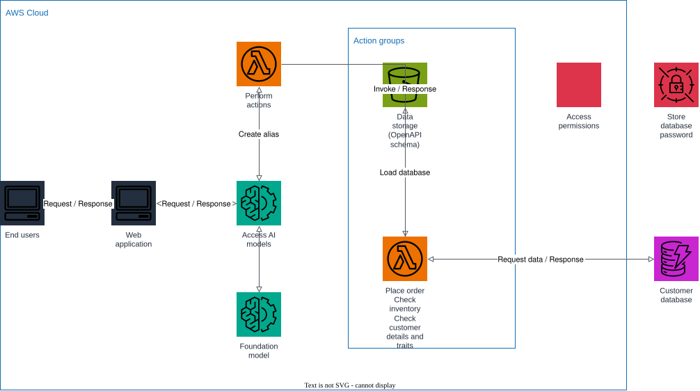

# AWS Project: Customer Service Bot

Create a customer service bot with real-time data integration, delivering up-to-date personalization and improved customer interactions.

1. an end user opens the web application and sends a request;
2. the web application forwards the request to a Bedrock agent (Access AI models), which resolves the user's intent with a foundation model;
3. when the intent requires real business data, the agent invokes its action group (Perform actions) — a Lambda function that can place orders, check inventory, and check customer details and traits;
4. the action group's OpenAPI schema lives in an S3 bucket (data storage) that Bedrock reads to understand which operations are available;
5. the action handler authenticates with a password stored in Secrets Manager, then loads live data from the customer database (DynamoDB), so answers always reflect real-time information.

## Prerequisites

- Docker
- Terraform 1.5+
- AWS CLI

## Start Floci

```bash
docker compose up -d
```

## Apply Terraform

```bash
terraform init
terraform apply
```

Applying:

- creates the `customer-database` DynamoDB table (seeded with two sample customers) and a Secrets Manager secret holding its password;
- uploads the action group's OpenAPI schema to the `action-group-schema` S3 bucket;
- deploys the `action-handler` Lambda (place order / check inventory / check customer details and traits) and grants Bedrock permission to invoke it;
- creates the Bedrock agent, its action group, and a `prod` alias;
- deploys the `chat-gateway` Lambda (with a public Function URL) that calls `bedrock-agent-runtime.invoke_agent` on behalf of the web application.

## Architecture



The diagram source is a real, editable [draw.io](https://www.drawio.com/) file at [docs/architecture.drawio](docs/architecture.drawio), generated programmatically with the [drawpyo](https://github.com/MerrimanInd/drawpyo) Python library. Open the `.drawio` file directly on GitHub or with the draw.io desktop app / [app.diagrams.net](https://app.diagrams.net/) to edit it.

To regenerate the diagram (`.drawio` source + the `.svg`/`.png` embedded above) after changing the architecture:

```bash
python3 -m venv .diagram-venv
.diagram-venv/bin/pip install drawpyo
.diagram-venv/bin/python scripts/generate_diagram.py

# rasterize the .drawio file to svg/png (used by the README) via headless draw.io
docker run --rm -v "$PWD/docs":/data -w /data rlespinasse/drawio-export -f svg -o . --output-mode relative --remove-page-suffix .
docker run --rm -v "$PWD/docs":/data -w /data rlespinasse/drawio-export -f png -o . --output-mode relative --remove-page-suffix -t .
```

## Chat with the bot

```bash
CHAT_URL=$(terraform output -raw chat_gateway_function_url)

curl -s -X POST "$CHAT_URL" \
  -H "Content-Type: application/json" \
  -d '{"prompt": "Can you check the inventory for prod-100?"}' | jq

curl -s -X POST "$CHAT_URL" \
  -H "Content-Type: application/json" \
  -d '{"prompt": "What tier is customer cust-001?"}' | jq
```

## Open the web app

Open [web/index.html](web/index.html) directly in a browser, paste the `chat_gateway_function_url` output into the input box, and start chatting.

If you want to follow the execution, watch the Floci container logs:

```bash
docker compose logs -f floci
```

## Clean up

```bash
terraform destroy
docker compose down
```
